## About

## Experience

| Where | What I did |
|---|---|
| **InComm Payments** Systems Engineer Intern · Sep 2026 – Now | SFTP batch-platform migration and client onboarding · failure alerts for enterprise file workflows |
| **Cornell Tech × Break Through Tech** AI/ML Fellow · Apr 2026 – Now | Neural nets, RAG and multimodal LLMs · applied ML pipelines with an industry partner |
| **IBM** SRE Intern · May – Aug 2026 | Sentinel ops dashboard (React/Django/PostgreSQL) for 50+ engineers · correlation-ID tracing · Terraform/Terragrunt |
| **Signify** Software Engineer Intern · Jan – May 2026 | Hybrid on-prem/AWS/Azure environment · CI/CD work that cut build time 40% · BLE Mesh lighting |
| **Crescent Technology** AI Engineer Intern · Jul – Dec 2025 | RAG pipeline cut hallucinations 80% · latency 11–13 s → under 4 s · ~20% fewer tokens |

## Featured Projects

<table>
<tr>
<td width="50%" valign="top">

 Distributed job scheduler in Go + Rust: etcd leader election, GPU-aware placement, heartbeat leases, and exactly-once results with fencing tokens. Chaos tests kill workers and the leader.
</td>
<td width="50%" valign="top">

 Price/time matching engine with deterministic replay and UDP market-data ingestion. Profiling showed the order-ID index ate half the cycles; replacing it took throughput from 12.4M to 17.2M events/s.
</td>
</tr>
<tr>
<td width="50%" valign="top">

 CUDA, NCCL and MPI experiments on a local RTX 5070 and cloud H100s: a warp-shuffle reduction at ~625 GB/s (93% of DRAM peak) and NCCL all-reduce at 344 GB/s on 2× H100.
</td>
<td width="50%" valign="top">

 Live AI finance tracker: Gemini receipt scanning, budget alerts, recurring transactions and AI monthly reports by email. <a href="https://github.com/zakiscoding/Kash">Code</a> · <a href="https://kash-nine.vercel.app">Live</a>
</td>
</tr>
<tr>
<td width="50%" valign="top">

 Self-hosted ML platform on k3s: Postgres job queue with leases and retries, Qdrant RAG, Prometheus/Grafana and MLflow, shipped as an 11-service Helm chart via Argo CD.
</td>
<td width="50%" valign="top">

 Redis-compatible server in C: RESP protocol, nonblocking event loop, and an append-only log that recovers cleanly from torn writes.
</td>
</tr>
</table>

<b>More projects</b>

 

- **[QuickBite](https://github.com/zakiscoding/AI-FoodDelivery-App)** · [live](https://team-sleep-liart.vercel.app): team food-delivery app with an AI ordering assistant (Next.js, Supabase, OpenAI)
- **[Multimodal Emotion AI](https://github.com/zakiscoding/EMOTION-Multimodal-AI-Model)**: video + audio + text late-fusion model on MELD, trained and served on SageMaker
- **[Audio CNN](https://github.com/zakiscoding/Audio_CNN)** · [live](https://audio-cnn-saas.vercel.app): residual CNN on ESC-50, 78.5% validation accuracy
- **[Housing MLOps](https://github.com/zakiscoding/Housing-Regression-Model)**: XGBoost + Optuna + MLflow, two services on ECS Fargate via GitHub Actions
- **[Low-Latency Trading Engine](https://github.com/zakiscoding/low-latency-trading-engine)**: C++ engine on live market data with paper trading
- **[Kubernetes CI/CD](https://github.com/zakiscoding/amazon-prime)**: Jenkins → SonarQube → Trivy → ECR → EKS with Argo CD

## Tech Stack

   
   
  

Also: CUDA · NCCL · vLLM · Hugging Face · LangChain · MLflow · Qdrant · gRPC · etcd · Helm · Argo CD · Prometheus · OpenShift

