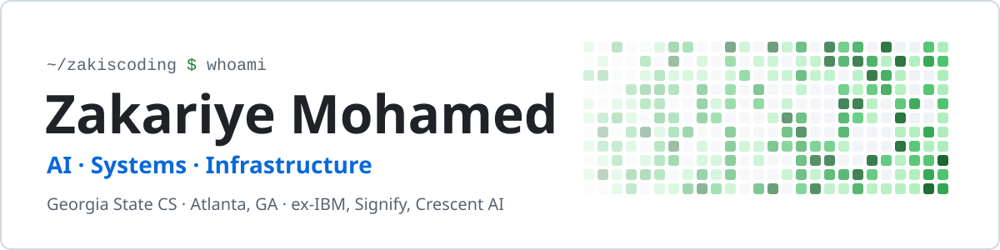
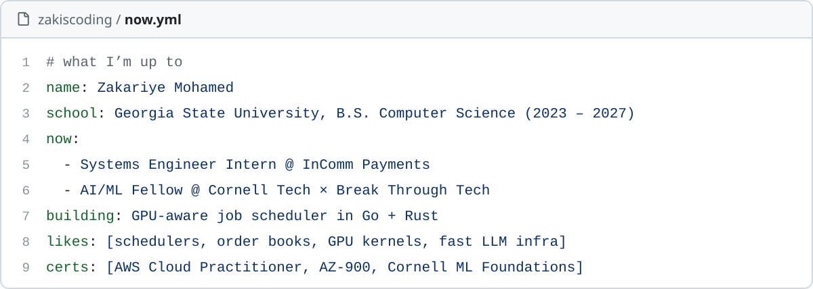
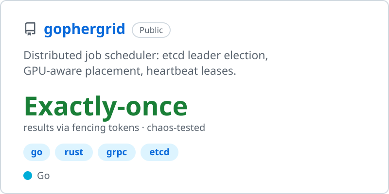
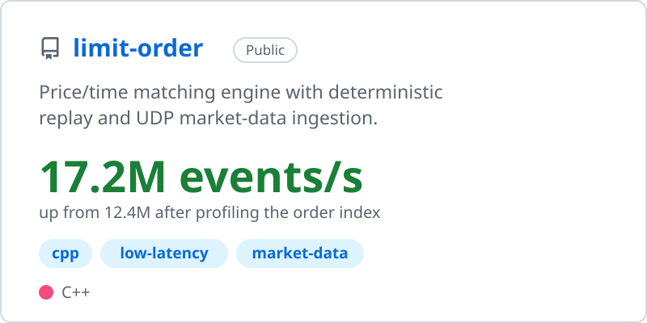
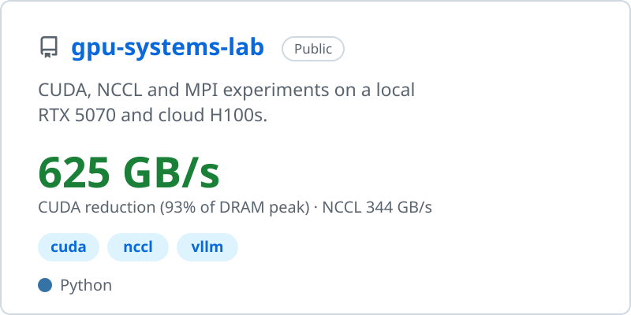
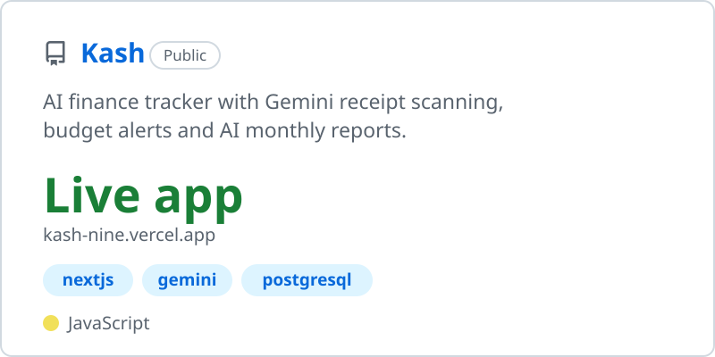
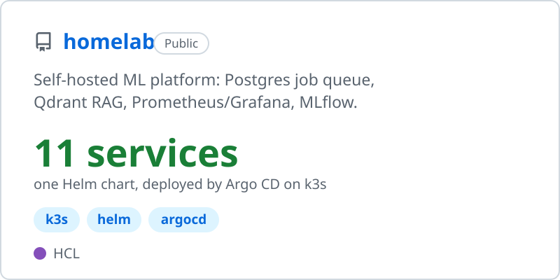
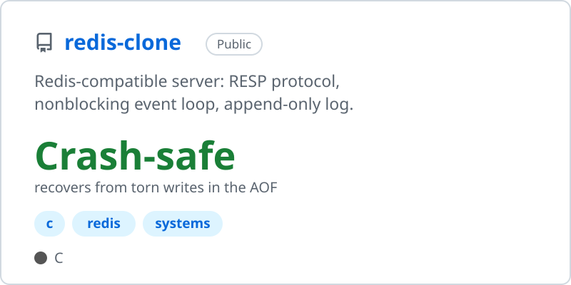

<a href="https://zakariye-mohamed.vercel.app"><picture><source media="(prefers-color-scheme: dark)" srcset="assets/banner-dark.svg"><source media="(prefers-color-scheme: light)" srcset="assets/banner-light.svg"></picture></a>

<picture><source media="(prefers-color-scheme: dark)" srcset="assets/divider-dark.svg"><source media="(prefers-color-scheme: light)" srcset="assets/divider-light.svg"></picture>

## About

<picture><source media="(prefers-color-scheme: dark)" srcset="assets/now-dark.svg"><source media="(prefers-color-scheme: light)" srcset="assets/now-light.svg"></picture>

## Experience

| Where | What I did |
|---|---|
| **InComm Payments** Systems Engineer Intern · Sep 2026 – Now | SFTP batch-platform migration and client onboarding · failure alerts for enterprise file workflows |
| **Cornell Tech × Break Through Tech** AI/ML Fellow · Apr 2026 – Now | Neural nets, RAG and multimodal LLMs · applied ML pipelines with an industry partner |
| **IBM** SRE Intern · May – Aug 2026 | Sentinel ops dashboard (React/Django/PostgreSQL) for 50+ engineers · correlation-ID tracing · Terraform/Terragrunt |
| **Signify** Software Engineer Intern · Jan – May 2026 | Hybrid on-prem/AWS/Azure environment · CI/CD work that cut build time 40% · BLE Mesh lighting |
| **Crescent Technology** AI Engineer Intern · Jul – Dec 2025 | RAG pipeline cut hallucinations 80% · latency 11–13 s → under 4 s · ~20% fewer tokens |

## Featured Projects

  <a href="https://github.com/zakiscoding/gophergrid"><picture><source media="(prefers-color-scheme: dark)" srcset="assets/projects/gophergrid-dark.svg"><source media="(prefers-color-scheme: light)" srcset="assets/projects/gophergrid-light.svg"></picture></a>
  <a href="https://github.com/zakiscoding/limit-order"><picture><source media="(prefers-color-scheme: dark)" srcset="assets/projects/limit-order-dark.svg"><source media="(prefers-color-scheme: light)" srcset="assets/projects/limit-order-light.svg"></picture></a>
  <a href="https://github.com/zakiscoding/gpu-systems-lab"><picture><source media="(prefers-color-scheme: dark)" srcset="assets/projects/gpu-lab-dark.svg"><source media="(prefers-color-scheme: light)" srcset="assets/projects/gpu-lab-light.svg"></picture></a>
  <a href="https://kash-nine.vercel.app"><picture><source media="(prefers-color-scheme: dark)" srcset="assets/projects/kash-dark.svg"><source media="(prefers-color-scheme: light)" srcset="assets/projects/kash-light.svg"></picture></a>
  <a href="https://github.com/zakiscoding/homelab"><picture><source media="(prefers-color-scheme: dark)" srcset="assets/projects/homelab-dark.svg"><source media="(prefers-color-scheme: light)" srcset="assets/projects/homelab-light.svg"></picture></a>
  <a href="https://github.com/zakiscoding/redis-clone"><picture><source media="(prefers-color-scheme: dark)" srcset="assets/projects/redis-dark.svg"><source media="(prefers-color-scheme: light)" srcset="assets/projects/redis-light.svg"></picture></a>

<b>More projects</b>

 

- **[QuickBite](https://github.com/zakiscoding/AI-FoodDelivery-App)** · [live](https://team-sleep-liart.vercel.app): team food-delivery app with an AI ordering assistant (Next.js, Supabase, OpenAI)
- **[Multimodal Emotion AI](https://github.com/zakiscoding/EMOTION-Multimodal-AI-Model)**: video + audio + text late-fusion model on MELD, trained and served on SageMaker
- **[Audio CNN](https://github.com/zakiscoding/Audio_CNN)** · [live](https://audio-cnn-saas.vercel.app): residual CNN on ESC-50, 78.5% validation accuracy
- **[Housing MLOps](https://github.com/zakiscoding/Housing-Regression-Model)**: XGBoost + Optuna + MLflow, two services on ECS Fargate via GitHub Actions
- **[Low-Latency Trading Engine](https://github.com/zakiscoding/low-latency-trading-engine)**: C++ engine on live market data with paper trading
- **[Kubernetes CI/CD](https://github.com/zakiscoding/amazon-prime)**: Jenkins → SonarQube → Trivy → ECR → EKS with Argo CD

## Tech Stack

   
   
  

Also: CUDA · NCCL · vLLM · Hugging Face · LangChain · MLflow · Qdrant · gRPC · etcd · Helm · Argo CD · Prometheus · OpenShift

<picture><source media="(prefers-color-scheme: dark)" srcset="assets/divider-dark.svg"><source media="(prefers-color-scheme: light)" srcset="assets/divider-light.svg"></picture>
